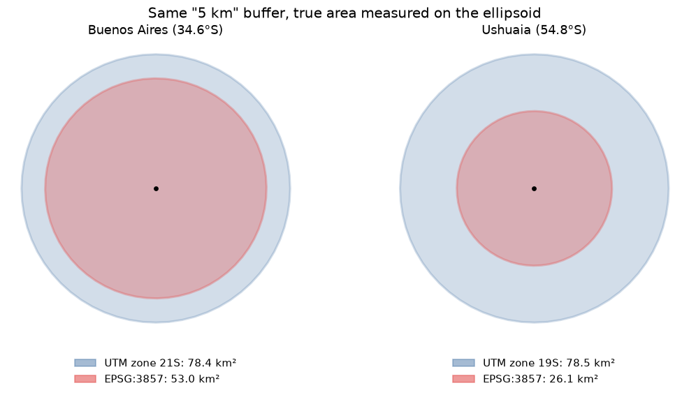
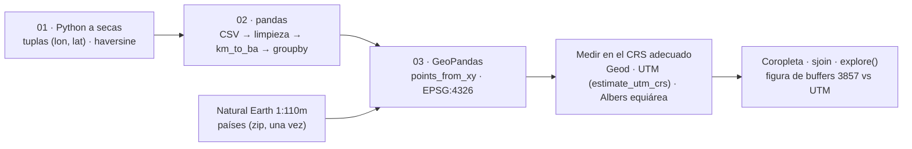

# python-gis-basics

[](requirements.txt) [](LICENSE)

**Introducción a GIS con Python en tres notebooks (Python a secas → pandas → GeoPandas) que corren de punta a punta, y la medición del error clásico del que empieza: un buffer de "5 km" dibujado en Web Mercator cubre 53 km² en Buenos Aires y 26 km² en Ushuaia, en vez de 78,5 km².**



Datos chicos escritos en los notebooks (12 ciudades argentinas) más los países de Natural Earth 1:110m, que se bajan una vez (~200 KB). Sin API keys. Los notebooks están en inglés. *Read in [English](README.md).*

| Notebook | Qué cubre | Colab |
|---|---|---|
| [01 · Python para GIS](notebooks/01_Intro_To_Python_Gis.ipynb) | Variables, listas, dicts, `if`, `for` y funciones sobre coordenadas; Pitágoras en grados vs haversine | [](https://colab.research.google.com/github/oechenique/python-gis-basics/blob/main/notebooks/01_Intro_To_Python_Gis.ipynb) |
| [02 · Datos tabulares](notebooks/02_Working_With_Data.ipynb) | pandas: leer un CSV con dos problemas sembrados, inspeccionar, limpiar, columnas nuevas, `groupby`, guardar | [](https://colab.research.google.com/github/oechenique/python-gis-basics/blob/main/notebooks/02_Working_With_Data.ipynb) |
| [03 · Geodatos](notebooks/03_Intro_To_Geodata.ipynb) | Geometrías de shapely, GeoDataFrame + CRS, longitudes geodésicas, coropleta de densidad en equiárea, `sjoin`, `explore()` y el buffer en 3857 vs UTM | [](https://colab.research.google.com/github/oechenique/python-gis-basics/blob/main/notebooks/03_Intro_To_Geodata.ipynb) |

## Arquitectura



El curso va de números a geometrías. El 01 trata las coordenadas como tuplas y muestra por qué un grado no es una distancia. El 02 arma las mismas ciudades como tabla, con una región faltante y una coma decimal para corregir. El 03 las convierte en GeoDataFrame, suma una capa real (Natural Earth) y mide todo en el CRS que corresponde a cada pregunta: el elipsoide para longitudes, una proyección equiárea para superficies y la zona UTM local para buffers.

## Qué demuestra

- **Un buffer de "5 km" en EPSG:3857 no mide 5 km.** Área real sobre el elipsoide WGS84: **53,0 km² en Buenos Aires (−33 %) y 26,1 km² en Ushuaia (−67 %)**; el mismo buffer en la zona UTM de cada ciudad (21S y 19S, con `estimate_utm_crs()`) da 78,4 y 78,5 km² ([notebook 03, sección 7](notebooks/03_Intro_To_Geodata.ipynb)).
- **Los grados no son distancias.** Buenos Aires–Córdoba da "6,62" con Pitágoras en grados y 647 km con haversine; los km por "grado" van de 93 a 106 según el destino, porque 1° de longitud son 101 km en Salta y 64 km en Ushuaia ([notebook 01](notebooks/01_Intro_To_Python_Gis.ipynb)).
- **Longitud geodésica vs proyectada.** Buenos Aires → Rosario → Córdoba: 653,5 km sobre el elipsoide y 653,6 km en UTM 20S ([notebook 03, sección 3](notebooks/03_Intro_To_Geodata.ipynb)).
- **Los límites generalizados engañan a los joins.** Con 1:110m, `sjoin` pone Posadas en Paraguay y Mar del Plata en el mar: 10 de 12 ciudades bien asignadas ([notebook 03, sección 6](notebooks/03_Intro_To_Geodata.ipynb)).

## Decisiones y lo que aprendí

- **La versión de 2024 no corría** → reescrita en las mismas rutas, así los links viejos de Colab siguen andando; los originales están en [`legacy/`](legacy/) con una nota de por qué fallaba cada uno (archivos de entrada inexistentes, funciones que nunca se llamaban, buffers en 3857).
- **Sin archivos de entrada que puedan faltar** → las ciudades están escritas en los notebooks y el 02 genera su propio CSV; la única descarga es Natural Earth, cacheada en `data/`.
- **Un CRS por pregunta** → `pyproj.Geod` para longitudes, Albers Sudamérica (`ESRI:102033`) para superficies de países y `estimate_utm_crs()` para buffers.

## Límites

- Es material introductorio, no un curso completo: tres notebooks, 12 ciudades, sin rásters, redes ni estadística espacial.
- Natural Earth 1:110m sirve solo para mapas de escala chica; el notebook muestra dónde falla (ciudades de frontera y de costa).
- Las coordenadas son puntos del centro de cada ciudad, redondeadas a 4 decimales.

## Stack por capa

| Capa | Tecnología |
|---|---|
| Tablas | pandas 3.1, numpy 2.5 |
| Geometrías y CRS | GeoPandas 1.2, shapely 2.2, pyproj 3.8, pyogrio 0.13 |
| Mapas | matplotlib 3.11, folium 0.20 + mapclassify 2.11 (`explore()`) |
| Entorno | Python 3.12, JupyterLab / Google Colab |

## Estructura del repo

| Carpeta | Qué hay |
|---|---|
| [`notebooks/`](notebooks/) | Los tres notebooks, con outputs |
| [`docs/img/`](docs/img/) | Figura que genera el notebook 03 |
| [`legacy/`](legacy/) | Los notebooks de diciembre de 2024, sin cambios, y por qué no corrían |

## Cómo reproducirlo

En Colab, con los badges de arriba. En local (probado en Windows 11 con Python 3.12.10, el 2026-11-02):

```powershell
python -m venv .venv
.venv\Scripts\python.exe -m pip install -r requirements.txt
.venv\Scripts\python.exe -m jupyter lab notebooks
```

El notebook 03 baja `ne_110m_admin_0_countries.zip` a `notebooks/data/` la primera vez.

## Licencias y atribución

- Código: [MIT](LICENSE).
- [Natural Earth](https://www.naturalearthdata.com/about/terms-of-use/) 1:110m Admin 0 países: dominio público.
- Coordenadas de las ciudades: cargadas a mano desde fuentes públicas, centros aproximados.
