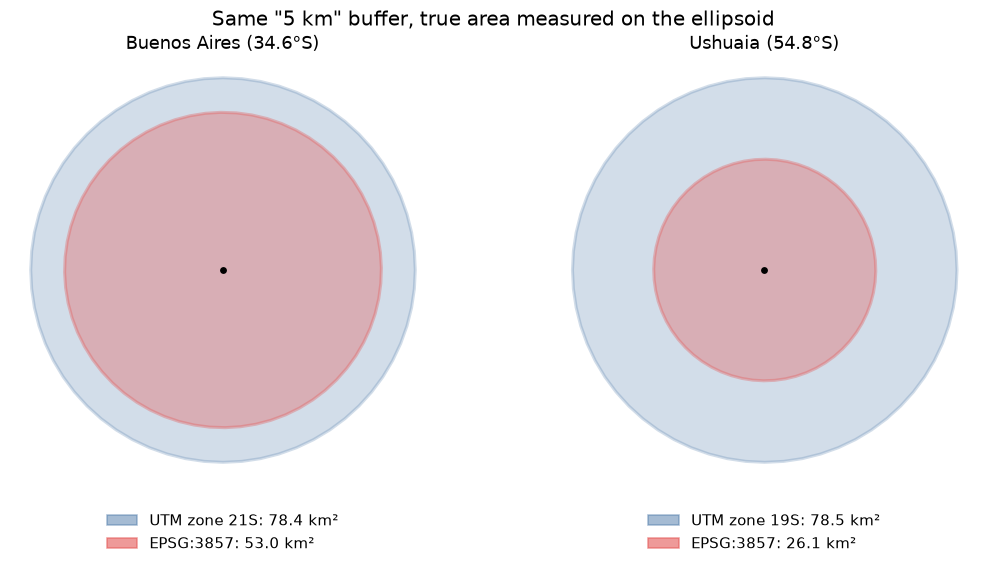
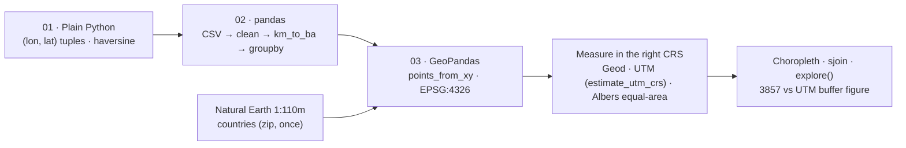

# python-gis-basics

[](requirements.txt) [](LICENSE)

**A three-notebook intro to GIS with Python (plain Python → pandas → GeoPandas) that runs end to end, and a measurement of the classic beginner mistake: a "5 km" buffer drawn in Web Mercator covers 53 km² in Buenos Aires and 26 km² in Ushuaia, instead of 78.5 km².**



Small data typed in the notebooks (12 Argentine cities) plus Natural Earth 1:110m countries, downloaded once (~200 KB). No API keys. *Leer en [español](README.es.md).*

| Notebook | What it covers | Colab |
|---|---|---|
| [01 · Python for GIS](notebooks/01_Intro_To_Python_Gis.ipynb) | Variables, lists, dicts, `if`, `for`, functions on coordinates; Pythagoras on degrees vs haversine | [](https://colab.research.google.com/github/oechenique/python-gis-basics/blob/main/notebooks/01_Intro_To_Python_Gis.ipynb) |
| [02 · Working with data](notebooks/02_Working_With_Data.ipynb) | pandas: read a CSV with two planted problems, inspect, clean, new columns, `groupby`, save | [](https://colab.research.google.com/github/oechenique/python-gis-basics/blob/main/notebooks/02_Working_With_Data.ipynb) |
| [03 · Geodata](notebooks/03_Intro_To_Geodata.ipynb) | shapely geometries, GeoDataFrame + CRS, geodesic lengths, equal-area density choropleth, `sjoin`, `explore()`, and the 3857 vs UTM buffer | [](https://colab.research.google.com/github/oechenique/python-gis-basics/blob/main/notebooks/03_Intro_To_Geodata.ipynb) |

## Architecture



The course goes from numbers to geometries. Notebook 01 treats coordinates as tuples and shows why a degree is not a distance. Notebook 02 builds the same cities as a table, with a missing region and a decimal comma to fix. Notebook 03 turns them into a GeoDataFrame, adds a real layer (Natural Earth) and measures everything in a CRS that fits the question: the ellipsoid for lengths, an equal-area projection for areas, the local UTM zone for buffers.

## What it shows

- **A "5 km" buffer in EPSG:3857 is not 5 km.** True area on the WGS84 ellipsoid: **53.0 km² in Buenos Aires (−33 %) and 26.1 km² in Ushuaia (−67 %)**; the same buffer in the city's UTM zone (21S and 19S, from `estimate_utm_crs()`) gives 78.4 and 78.5 km² ([notebook 03, section 7](notebooks/03_Intro_To_Geodata.ipynb)).
- **Degrees are not distances.** Buenos Aires–Córdoba is "6.62" by Pythagoras on degrees and 647 km by haversine; the km-per-"degree" ratio changes from 93 to 106 depending on the destination, because 1° of longitude is 101 km in Salta and 64 km in Ushuaia ([notebook 01](notebooks/01_Intro_To_Python_Gis.ipynb)).
- **Geodesic vs projected length.** Buenos Aires → Rosario → Córdoba: 653.5 km on the ellipsoid, 653.6 km in UTM 20S ([notebook 03, section 3](notebooks/03_Intro_To_Geodata.ipynb)).
- **Generalised borders mislead joins.** With 1:110m borders, `sjoin` puts Posadas in Paraguay and Mar del Plata in the sea: 10 of 12 cities matched correctly ([notebook 03, section 6](notebooks/03_Intro_To_Geodata.ipynb)).

## Decisions and what I learned

- **The 2024 version did not run** → rewritten at the same paths, so the old Colab links still work; originals in [`legacy/`](legacy/) with a note on why each one failed (missing input files, functions never called, 3857 buffers).
- **No input files to go missing** → the cities are typed in the notebooks and notebook 02 writes its own CSV; the only download is Natural Earth, cached in `data/`.
- **A CRS per question** → `pyproj.Geod` for lengths, Albers South America (`ESRI:102033`) for country areas, `estimate_utm_crs()` for buffers.

## Limits

- Teaching material, not a full course: three notebooks, 12 cities, no rasters, networks or spatial statistics.
- Natural Earth 1:110m is for small-scale maps only; the notebook shows where it fails (border and coastal cities).
- City coordinates are city-centre points, rounded to 4 decimals.

## Stack

| Layer | Technology |
|---|---|
| Tables | pandas 3.1, numpy 2.5 |
| Geometries and CRS | GeoPandas 1.2, shapely 2.2, pyproj 3.8, pyogrio 0.13 |
| Maps | matplotlib 3.11, folium 0.20 + mapclassify 2.11 (`explore()`) |
| Runtime | Python 3.12, JupyterLab / Google Colab |

## Repo structure

| Folder | Contents |
|---|---|
| [`notebooks/`](notebooks/) | The three notebooks, with outputs |
| [`docs/img/`](docs/img/) | Figure generated by notebook 03 |
| [`legacy/`](legacy/) | The December 2024 notebooks, unchanged, and why they did not run |

## How to run it

On Colab, click a badge above. Locally (tested on Windows 11 with Python 3.12.10, 2026-11-02):

```powershell
python -m venv .venv
.venv\Scripts\python.exe -m pip install -r requirements.txt
.venv\Scripts\python.exe -m jupyter lab notebooks
```

Notebook 03 downloads `ne_110m_admin_0_countries.zip` to `notebooks/data/` on first run.

## Licenses and attribution

- Code: [MIT](LICENSE).
- [Natural Earth](https://www.naturalearthdata.com/about/terms-of-use/) 1:110m Admin 0 countries: public domain.
- City coordinates: typed by hand from public sources, approximate city centres.
